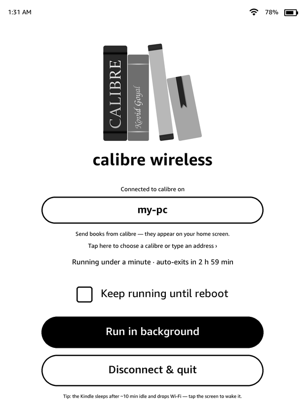
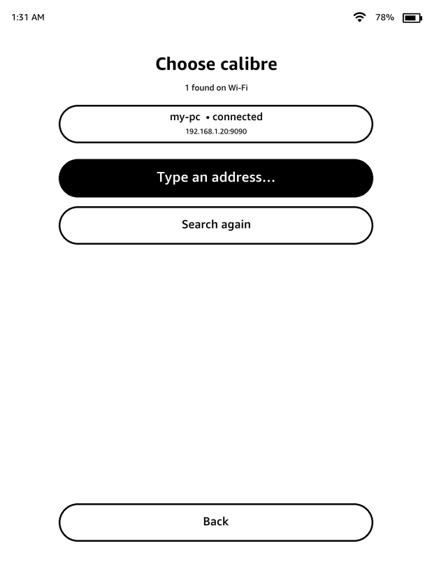
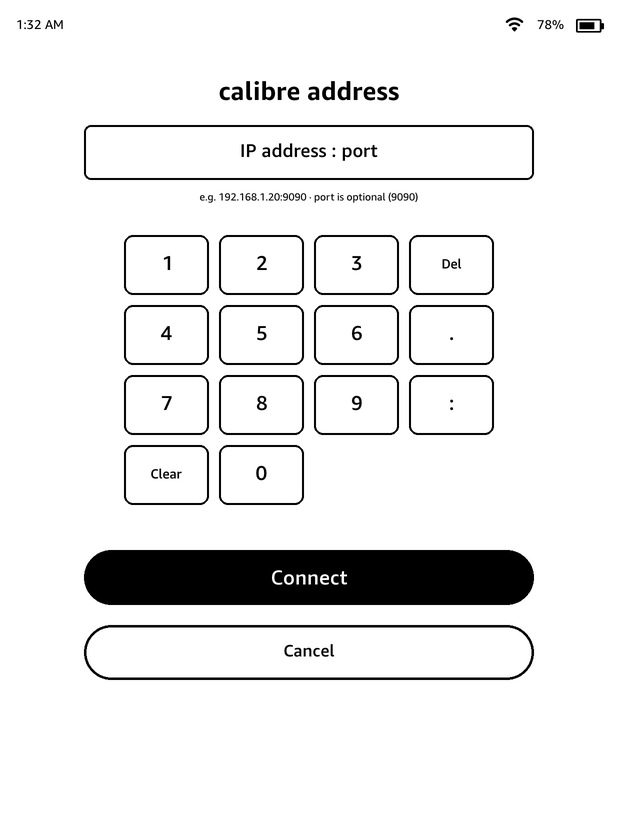

# calibre wireless — for jailbroken Kindles

Your Kindle shows up in calibre over Wi-Fi exactly like a USB-connected device:
green "On Device" ticks, **Send to device**, delete, the Device book list.
Books land in `documents/` as native Kindle files and open in the normal
Kindle reader. A tap on the **calibre wireless** tile in your library connects;
a full-screen e-ink app shows status, a session timer, *Run in background*,
*Keep running until reboot* and *Disconnect & quit*.

Standalone: nothing else needs to be installed on the Kindle. No KOReader.



## Requirements

* A touchscreen Kindle on firmware 5.x, **jailbroken** with a current method
  (anything that gives you `jb.sh`/KPM: WinterBreak, SpringBreak, Shadow,
  SpiderCat, …). On older KUAL-era jailbreaks the KUAL menu entry is installed
  instead of the library tile.
* Supported ABIs: `kindlehf` (Paperwhite 4/5/6, Basic 4/5/6, Oasis 2/3,
  Scribe, Colorsoft) and `kindlepw2` (Paperwhite 2/3, Voyage, Oasis 1,
  Basic 2/3). Kindle Touch / Paperwhite 1 need a legacy build (not yet).
* calibre on your PC, with its wireless listener allowed through the firewall
  (Windows asks once).

## Install

With KPM (recommended):

```
;kpm add-repo https://funkedope.github.io/calibri-wireless/repo/manifest.json
;kpm update
;kpm install calibre-wireless
```

Or, with Jobman's SSH enabled on the Kindle, install the `.kpkg` from
Releases over SSH:

```
set KINDLE_PW=kindle
python tools/deploy.py <kindle-ip> dist/calibre-wireless_1.0.0_kindlehf-kindlepw2.kpkg
```

Everything lives in `/mnt/us/calibre-wireless/`.

## Use

1. calibre running; the wireless listener on (Connect/share → *Start wireless
   device connection*; tick "start automatically" in its settings once).
2. Kindle awake, on Wi-Fi, **not** mounted as a USB drive on the PC (that
   turns Wi-Fi off) — a wall charger is fine.
3. Tap **calibre wireless** in the library. Within ~10 s calibre shows the
   device. Send books. Tap *Run in background* to close the app and keep the
   connection; it auto-exits after `max_idle_minutes` without calibre (or
   tick *Keep running until reboot*).

## Several calibres, or no discovery

The daemon asks the whole LAN who is running calibre: limited broadcast,
then subnet-directed broadcast, then a unicast sweep of the local /24 (PC
firewalls often drop broadcast but answer unicast). Every calibre that
replies is listed. One → it connects. Several → it reconnects to the one you
used last time, or shows the chooser if there is no history. Tap the status
area in the app to open **Choose calibre** (every instance found, by PC name
and address), or **Type an address…** for a keypad (IP, optional `:port`,
default 9090). A fixed address can also be set in `config.lua`
(`calibre_host` / `calibre_port`).

| chooser | keypad |
|---|---|
|  |  |

## Dark mode

`theme = "auto"` reads the Kindle's dark-mode flag from the framebuffer and
follows it; `"light"` / `"dark"` force it. On the Paperwhite 5 the driver
inverts everything globally in dark mode, so the app simply draws as usual
and comes out white-on-black (verified). If a model shows the app inverted
the wrong way, set `dark_draw_invert = true`.

## Choosing the format calibre sends

`/mnt/us/calibre-wireless/config.lua` → `formats = { "azw3", "mobi", ... }`.
calibre sends the first listed format the book already has; if it has none,
it **converts to the first one**. The default list omits `epub` on purpose so
EPUB-only books arrive as AZW3 and open natively. The list is mirrored in
calibre under Preferences → Plugins → Device plugins → SmartDevice App
Interface.

## How it works

`lua/companion.lua` implements calibre's *Smart Device App* protocol
(UDP discovery on calibre's broadcast ports, length-prefixed JSON over TCP,
streamed book binaries) and keeps `books.json` as the device's view of what
calibre sent, seeded from calibre's USB `metadata.calibre` when present so
existing books match. `lua/ui.lua` is the app: it draws with FBInk, reads the
touchscreen from `/dev/input` (auto-detected, scaled from the panel's own
coordinate range), pauses the Kindle window manager while open, and talks to
the daemon through `state.json` / `cmd.*` files. `run.sh` picks the ABI and
wires the bundled runtime.

Protocol references: calibre `src/calibre/devices/smart_device_app/driver.py`;
KOReader `plugins/calibre.koplugin/`.

## Repository layout

```
src/lua/        companion.lua (daemon), ui.lua (app), json.lua, vendor/ (socket.lua, dkjson.lua)
src/run.sh      launcher (start|stop|status|app)
src/config.lua  default settings
src/scriptlets/ library tile;  src/kual/  KUAL menu
runtime/<abi>/  luajit, fbink, lfs.so, socket/score.so  (tools/fetch_runtime.py)
assets/         PNG assets (+ src/ generator)
kpm/            manifest.json, install.sh, uninstall.sh, launch.sh
tools/          build.py (.kpkg), deploy.py (install over SSH), qc_shots.py (screenshots), dev helpers
```

Tested on a Paperwhite 5 (1236x1648) and a Paperwhite 4 (1072x1448), both
firmware 5.18/5.19 with SpringBreak. Screenshots in `screenshots/` are
rendered from a placeholder state with `tools/qc_shots.py`.

Build: `python tools/fetch_runtime.py && python tools/build.py` →
`dist/calibre-wireless_<ver>_kindlehf-kindlepw2.kpkg`. To re-render the
PNG assets: `tools/fetch_device_art.py <ip>` (Ember fonts and the Kindle's
status-bar icons, from a device), then `assets/src/make_assets.py
<calibre library.png> fonts assets icons`.

## Limits

* The Kindle must be awake; it suspends after ~10 min idle and drops Wi-Fi.
  While the app is open it stays awake; in the background only on a charger
  (`keep_awake` in config).
* No boot-time autostart (would need a root filesystem write). Tap to start.
* calibre's wireless password is not supported; leave it blank.

## License

MIT for this project's code; bundled components keep their own licenses —
see `THIRD_PARTY.md`.
